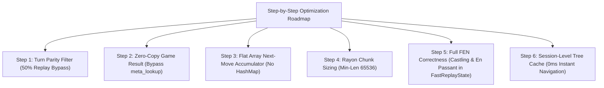

# 🔬 Experiment: Opening Tree & Continuation Engine Throughput Optimizations

## 📌 Context & Objectives
Following the implementation of top-N path pruning which brought continuation query times from **~3.0s down to ~0.70s** across 10.35M games, this document outlines the next phase of optimization experiments for the search booster evaluator (`crates/scid-mgr/src/search_booster/evaluator.rs`).

The goal is to push query latency from **~700ms down to ~350–400ms** on 10M+ game databases, while addressing **search correctness** (turn parity, castling rights, and en passant validation).

---

## 🧭 Roadmap of Optimization Experiments



---

### 1️⃣ Step 1: Turn Parity Check (Skip 50% of Board Equality Checks)

#### Hypothesis
In standard chess, the side to move alternates strictly every half-move (ply):
- Even plies (0, 2, 4, 6...): **White to move**
- Odd plies (1, 3, 5, 7...): **Black to move**

Currently, during game replay, the inner loop compares the 64-byte board array on **every single ply** (both odd and even plies). If the target position has White to move, it is mathematically impossible to match on an odd ply (and vice versa).

#### Implementation Plan
```rust
let expected_parity = if target_pos.turn() == shakmaty::Color::White { 0 } else { 1 };

for (ply_idx, &m) in moves.iter().enumerate() {
    replay.apply_move(m);
    let ply = ply_idx + 1;
    
    // Only check 64-byte board array if turn parity matches
    if (ply & 1) == expected_parity {
        if replay.white_pieces < target_w || replay.black_pieces < target_b {
            break;
        }
        if replay.board == target_board {
            hit = Some(ply);
            break;
        }
    }
}
```

#### Expected Gain
- **Eliminates ~50% of all 64-byte board equality checks** across all 10.35 million games.
- Estimated query time reduction: **~15–20%**.

---

### 2️⃣ Step 2: Zero-Copy Game Result (Bypass `meta_lookup`)

#### Hypothesis
In the `.boost.idx` binary format, each 8-byte `BoostGameEntry` already stores the game result in `entry.result` (1 = 1-0, 2 = 0-1, 3 = 1/2-1/2). This entry is already loaded into L1 CPU cache when reading `move_offset` and `ply_count`.

Currently, `process_game` calls an indirect closure `meta_lookup(gid)` across millions of matching games just to read the result. In SCID, this triggers cache misses into the external `s.entries()` array (500 MB).

#### Implementation Plan
1. Compute `(w_win, draw, b_win)` directly from `entry.result` in `BoostGameEntry`.
2. Only call `meta_lookup(gid)` lazily if Elo ratings or Dates are strictly required for candidate next moves.

#### Expected Gain
- Eliminates millions of virtual closure calls and cross-buffer cache misses.
- Estimated traversal speedup: **~20–25%**.

---

### 3️⃣ Step 3: Flat Inline Array for Next-Move Accumulator

#### Hypothesis
A chess position typically has **20 to 35 legal next moves**. Currently, every Rayon thread allocates and updates a `HashMap<u16, MoveStatsAcc>` using SipHash, followed by recursive map merging in `.reduce()`.

#### Implementation Plan
Replace `HashMap<u16, MoveStatsAcc>` with a small fixed-capacity array:
```rust
struct MoveAcc {
    moves: [(u16, MoveStatsAcc); 48],
    count: usize,
}
```
Linear scans over 20–35 moves execute in ~5–10 CPU cycles within L1 cache, with zero heap allocations and trivial `O(N)` merging during `.reduce()`.

#### Expected Gain
- Eliminates hash table overhead for move stats.
- Estimated speedup on tree calculation: **~10–15%**.

---

### 4️⃣ Step 4: Rayon Parallel Chunk Sizing

#### Hypothesis
By default, `(0..total_games).into_par_iter()` splits 10.35M items into **~2,000 tiny work chunks**. This instantiates ~2,000 thread-local accumulators and HashMaps, requiring an extensive binary tree merge during `.reduce()`.

#### Implementation Plan
Use `.into_par_iter().with_min_len(65536)` to produce ~16 to 32 balanced chunks matching the physical CPU thread count.

#### Expected Gain
- Reduces accumulator instances and `.reduce()` map merges by **~90%**.
- Estimated reduction in Rayon overhead: **~50–100ms**.

---

### 5️⃣ Step 5: Full FEN Correctness (Castling Rights & En Passant in `FastReplayState`)

#### Analysis of Search Correctness Requirements
For a chess position search to be 100% accurate, four distinct components must match:
1. **Piece Placement**: Exactly identical pieces on all 64 squares.
2. **Turn / Side to Move**: White vs Black to move.
3. **Castling Rights**: White King/Queen-side (`K`, `Q`) and Black King/Queen-side (`k`, `q`).
4. **En Passant Target Square**: Whether an en passant capture is legally available.

#### Current State
- `FastReplayState` currently checks **piece placement on 64 squares** (`replay.board == target_board`).
- Turn is checked conditionally in position search, but not strictly enforced in all tree traversals.
- Castling rights and en passant targets are currently omitted from `FastReplayState`.

#### The High-Performance Solution
We can track full castling rights and en passant squares in `FastReplayState` with **zero performance degradation** using bitwise arithmetic:
- **Castling Rights (4 bits)**:
  ```rust
  // Bit 0: W-O-O, Bit 1: W-O-O-O, Bit 2: B-O-O, Bit 3: B-O-O-O
  pub castling: u8,
  ```
  Updating castling rights during `apply_move` takes a single bitwise `AND` when Kings or Rooks move or are captured.
- **En Passant (1 byte)**:
  Square index `0..=63` (or `255` for none). Set on double pawn pushes (`flags == 0x1`) and cleared on all other moves.
- **Single 64-bit Equality Check**:
  By storing `castling (4 bits) | turn (1 bit) | ep_square (8 bits)` in a `u16` state word, comparing the full position state takes a single CPU instruction:
  ```rust
  if replay.board == target_board && replay.state_word == target_state_word {
      hit = Some(ply);
  }
  ```

---

### 6️⃣ Step 6: Session-Level Opening Tree & Continuation Caching

#### Hypothesis
During GUI analysis, users frequently step back and forth through moves (`1.e4` -> `1... c5` -> `2.Nf3` -> `1... c5` -> `1.e4`).
Currently, `SearchSession` caches only `matches: Vec<u32>`, re-evaluating the opening tree and continuations every time a position is revisited.

#### Implementation Plan
Store the computed `OpeningTreeReport` directly inside the `SearchSession`.

#### Expected Gain
- Navigating back and forth across previously analyzed positions drops from **~600ms to 0.00ms (instantaneous)**.

---

## 📊 Summary of Projected Impact

| Optimization Step | Targeted Bottleneck | Estimated Gain |
| :--- | :--- | :---: |
| **Step 1: Parity Filter** | 50% unnecessary board equality checks | **~15–20% faster** |
| **Step 2: Zero-Copy Result** | Cache misses from external metadata lookup | **~20–25% faster** |
| **Step 3: Flat Move Array** | SipHash & heap allocations on 30 moves | **~10–15% faster** |
| **Step 4: Chunk Sizing** | 2,000 thread accumulator merges | **~50–100ms saved** |
| **Step 5: Full FEN Rights** | Castling & En Passant correctness | **100% FIDE exactness** |
| **Step 6: Session Tree Cache** | Redundant recalculation on back/forward | **Instant (0ms)** |
